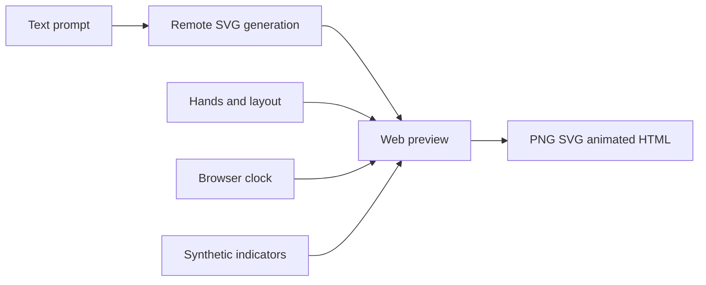

# ⌚ Apple Watch Cadrans

## Architecture constatée

Dans [index.html](index.html), generate sollicite Mistral pour produire du SVG, renderHands et startAnim composent et animent le cadran. exportWatch rastérise le SVG en PNG via Canvas ; exportSVG et exportHTML produisent des fichiers vectoriels et HTML animé. Date, jour et secondes proviennent de l'horloge locale ; fréquence cardiaque, pas et batterie sont des valeurs fictives. Aucun lien HealthKit ou capteur de montre établi.

Le SVG généré nécessite une validation et une isolation avant affichage/export ; l'extraction textuelle d'une balise ne garantit pas sa sécurité. Ne pas saisir de clé réelle ni ouvrir de fichier non vérifié tant que ces protections ne sont pas qualifiées. Les exports ne sont pas des cadrans watchOS natifs.

Qualification proposée : comparer dimensions, aiguilles, trois formats d'export, erreurs fournisseur et marquage des données simulées. Aucun test, appel distant ou déploiement effectué.

## English overview

Independent web watch-face concept editor with optional remote SVG generation and PNG, SVG and animated HTML exports. Heart rate, steps and battery indicators are simulated; no watch sensor or native watchOS integration is established. Generated markup requires security review. No new runtime or device validation.

[Notice de droits](LICENSE.md) : droits réservés, marques et droits tiers préservés.

## Ce que fait l'application, en pratique

Le studio permet de **concevoir et prévisualiser des cadrans** analogiques (aiguilles), numériques ou hybrides, de tester leur rendu dans un cadre de montre et d'**exporter une création en PNG, SVG ou HTML animé** selon l'option choisie.

**Statut :** outil de design web ; l'export HTML ou SVG n'est **pas un cadran watchOS installable** et n'implique aucune affiliation avec Apple.

**Studio Niko Design** — Concepts de cadrans Apple Watch personnalisés.

## 🛠 Stack
`HTML` · `CSS` · `SVG`

## 👤 Auteur
**Nicolas Julienne** — [Studio Niko Design](https://github.com/Nikoju1977)
📧 nicolasjulienne.nj@gmail.com

---

## Utilisation, périmètre et maturité

**Thème :** Design — concepts de cadrans.

Consulter `index.html` dans le navigateur (ou servir le dossier avec `python3 -m http.server 8000`). Le projet contient des concepts visuels réalisés en HTML, CSS et SVG.

**Portée :** la présence de maquettes ne signifie pas qu'il s'agit de cadrans watchOS signés, installables sur Apple Watch ou distribués sur l'App Store. « Apple Watch » est une marque d'Apple ; projet indépendant, sans affiliation revendiquée.

**État de validation :** documentation actualisée à partir de la structure du dépôt ; aucun test d'exécution, contrôle de sécurité ou audit réglementaire n'est revendiqué.

[Voir les autres projets Studio Niko Design](https://github.com/Nikoju1977).
